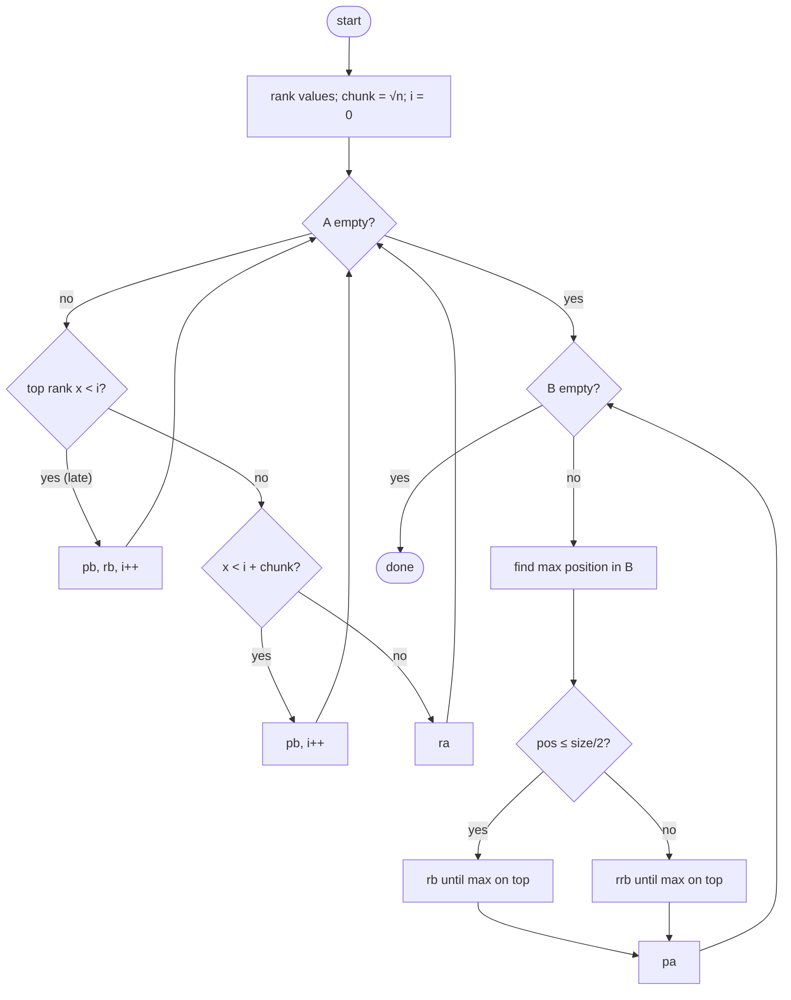
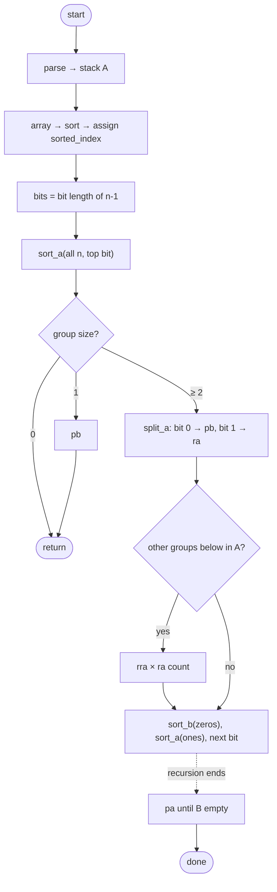

*This project has been created as part of the 42 curriculum by ochong, junlim.*

# push_swap

## Description

push_swap sorts a list of integers using two stacks, `a` and `b`, and a fixed set of 11 operations (`sa sb ss pa pb ra rb rr rra rrb rrr`). The program prints the sequence of operations that sorts stack `a` in ascending order, smallest on top. The goal is to use as few operations as possible. 

Rather than relying on standard array-based sorting, this project demands custom implementations that map to specific Push_swap operations (sa, pb, ra, rra, etc.), forcing strategic resource management and memory routing. The program evaluates an initial "disorder metric" and dynamically selects the most mathematically efficient sorting strategy based on the data size and entropy.

The binary contains four strategies:

| Flag | Strategy | Complexity (operations) |
|---|---|---|
| `--simple` | Selection (min extraction) | O(n²) |
| `--medium` | Chunk sort, sliding window | O(n√n) |
| `--complex` | MSD binary radix sort | O(n log n) |
| `--adaptive` (default) | Picks one of the above by disorder | depends on the regime |

All complexity classes are measured in **number of push_swap operations printed**, not in CPU work.

## Instructions

```sh
make                # builds libft, ft_printf, then push_swap
make clean          # removes object files (also in ft_printf and libft)
make fclean         # also removes the binary and libraries
make re
make selection      # ─┐
make chunk          #  ├─ builds ./push_swap only with selected algo
make radix          # ─┘
make visual         # visualize the stacks if needed. Aligned for single digits only
make norm           # norminette check on files needed for push_swap only
```

```sh
./push_swap 23 16 7712 19 2 917 7
./push_swap --simple 5 4 3 2 1
./push_swap --medium 67 87 12 457
./push_swap --complex 157 18 3 72
./push_swap "3 2 1"                       # a single quoted list also works

# check the result with the provided checker
ARG="4 67 3 87 23"; ./push_swap $ARG | ./checker_linux $ARG

# benchmark mode: stats go to stderr, operations stay on stdout
./push_swap --bench $ARG 2> bench.txt | ./checker_linux $ARG
```

On invalid input (non-integer, out of `int` range, duplicates) the program prints `Error` on stderr.

---
## Algorithm Explanation
### Simple Algorithm
#### Implementation
Selection Sort Adaptation
#### Justification
Ideal for small datasets (e.g., the 5-number test). The algorithm locates the smallest integer in Stack A and pushes it to Stack B. A critical optimization calculates the median index of the stack: if the target number is in the top half, we use ra (rotate up); if in the bottom half, we use rra (reverse rotate down).

### Medium Algorithm
#### Implementation
Chunk-Based Sorting
#### Justification
 Designed for mid-sized datasets or data with moderate disorder metrics ($0.20 \le \text{disorder} < 0.50$). This approach partitions Stack A into $\sqrt{n}$ manageable chunks based on value ranges. It pushes these chunks to Stack B in stages, reducing the search space, before pushing them back to Stack A in the correct sequence.
### Complex Algorithm
#### Implementation
Radix-Sort
#### Justification
Required for large, highly disordered datasets (e.g., the 500-number test). Because our operations simulate bitwise shifts, a binary Radix sort processes the integers bit by bit (from Least Significant to Most Significant).

### Adaptive Algorithm
#### Implementation
Auto Allocation based on Disorder Metric
#### Justification
< 0.20 Disorder: Routes to Simple $O(n^2)$

< 0.50 Disorder: Routes to Medium $O(n\sqrt{n})$

$\ge$ 0.50 Disorder: Routes to Complex $O(n \log n)$


## Technical choices

### 1. Data structure: circular doubly linked list

```c
typedef struct s_node
{
	int				num;
	int				sorted_index;
	struct s_node	*prev;
	struct s_node	*next;
}	t_node;

typedef struct s_stack
{
	t_node	*top;
	int		size;
}	t_stack;
```

**Why:** `ra` and `rra` need both ends of the stack. Only the circular doubly linked list reaches both in O(1).

| Structure | `ra` (top → bottom) | `rra` (bottom → top) |
|---|---|---|
| Singly | O(n): walk to the last node to attach the old top | O(n): walk to the 2nd-last node to detach the last |
| Singly + tail | O(1): `tail->next = top`, move top and tail | O(n): still need the node before the tail |
| Circular doubly | O(1): `top = top->next` | O(1): `top = top->prev` |

```
 top → [3] ⇄ [2] ⇄ [1]        last node = top->prev
 ra:   top = top->next   →   2 1 3
 rra:  top = top->prev   →   1 3 2
```

**Trade-off:** push fixes 4 pointers and pop fixes 2, and sizes 0 and 1 need special cases.

Related choices:
- **`t_stack *` instead of `t_node **`:** `size` is stored once and functions need no double pointers. `size` must be kept up to date by every push and pop.
- **`size` makes loops readable:** `while (i < stack->size)` instead of handling `top` first and then `while (cur != stack->top)` (no `do/while` under the Norm).
- **`sa` swaps values, not nodes:** simpler, no relinking but beaware when there are pointers for these nodes.

### 2. Preprocessing: ranking (`sorted_index`)

Before the medium and complex strategies run, each node gets its rank: its position (0 to n-1) in sorted order. The values are copied to an array, the array is sorted, each node is matched to its index, and the array is freed. This step prints no operations.

Why ranking matters:
- **Fewer bits:** radix depth depends on n (⌈log₂ n⌉ bits), not on the size of the values.
- **Negatives work:** ranks are never negative, so there is no sign-bit problem.
- **No gaps:** ranks are compact, so no recursion level is wasted.

For example: 

```
"1 2 99999" -> 99999 = 11000011010011111 (17 bits to compared)
"0 1 2"		-> 2 = 10 (2 bits to compared)
```
### 3. Simple strategy: selection, O(n²)

1. While A has more than 3 elements: `ra` until the minimum is on top, then `pb`.
2. Sort the last 3 directly.
3. `pa` until B is empty.

**Complexity:** n extractions × at most n rotations each → O(n²) operations.

### 4. Medium strategy: chunk sort (sliding window), O(n√n)

**Decision:** a sliding window instead of strict, fixed chunks.

| | |
|---|---|
| Compared | Insertion sort inside each chunk; strict fixed chunks; strict chunks with nearest-element search; sliding window |
| Why sliding | Allows more numbers to `pb` in every iteration. Reduce the cost to find the suitable element to push significantly. Strict chunks run out of targets at the end of each chunk and do long `ra` hunts. |
| Shape on B | If all the nums in A is pb to B after phase 1, it will looke like a 'M' that rotates 90 degrees to the right'|

### Example with chunk = 3 and 9 items in A:

| pb # | Size of A | Strict: targets | Strict: chance | Strict: ≈ ra | Sliding: targets | Sliding: chance | Sliding: ≈ ra |
|---|---|---|---|---|---|---|---|
| 1 | 9 | 3 | 33% | 1.5 | 3 | 33% | 1.5 |
| 2 | 8 | 2 | 25% | 2 | 3 | 38% | 1.25 |
| 3 | 7 | 1 | 14% | 3 | 3 | 43% | 1 |
| 4 | 6 | 3 | 50% | 0.75 | 3 | 50% | 0.75 |
| 5 | 5 | 2 | 40% | 1 | 3 | 60% | 0.5 |
| 6 | 4 | 1 | 25% | 1.5 | 3 | 75% | 0.25 |
| 7–9 | 3, 2, 1 | all | 100% | 0 | all | 100% | 0 |
| **Total** | | | | **9.75** | | | **5.25** |

- **Strict:** targets drop 3 → 2 → 1 inside each chunk, so the chance falls and the last target of each chunk is the most expensive.
- **Sliding:** each `pb` lets one new rank into the window, so targets stay at 3 while A shrinks. The chance only goes up.
- **≈ ra** is the expected number of `ra` before the next `pb`, (size − targets) ÷ (targets + 1), assuming targets are spread randomly in A. It compares the two methods; it overestimates real counts.

### How to calculate ≈ ra (average ra) at pb#3, 7 itmes in A (assuming):
| Case           | Size of A | Targets | Non-targets | Gaps (targets + 1) | Example layout (top → bottom) | ≈ ra before pb |
| -------------- | --------- | ------- | ----------- | ------------------ | ----------------------------- | -------------- |
| Strict, pb #3  | 7         | 1       | 6           | 2                  | `x x x T x x x`               | 6 ÷ 2 = **3**  |
| Sliding, pb #3 | 7         | 3       | 4           | 4                  | `x T x T x T x`               | 4 ÷ 4 = **1**  |

`T` = target, `x` = non-target. You `ra` past the gap in front of the first `T`, then `pb`. On average the non-targets split evenly across the gaps, so ≈ ra = (size − targets) ÷ (targets + 1).

**Steps**
1. Rank the values. `chunk = floor(√n)` (10 for 100, 22 for 500). `i = 0`.
2. **Phase 1**, while A is not empty, with `x` = rank on top of A:
   - `x < i` (late value): `pb`, `rb`, `i++`
   - `x < i + chunk`: `pb`, `i++`
   - otherwise: `ra`
3. **Phase 2**, while B is not empty: find the max in B, rotate it to the top with the shorter of `rb` / `rrb`, then `pa`.



**Complexity:** elements × cost per element = n × √n.

| | Bound |
|---|---|
| Phase 1 `ra` | O(n√n) worst case: the window always holds `chunk` targets |
| Phase 1 `pb` / `rb` | ≤ n each |
| Phase 2 | n pulls × about one chunk of rotations each → O(n√n) |
| Measured (simulation) | about 596 ops at n = 100, about 5,318 at n = 500 |

```
Phase 1:
iteration needed: ≤ n /s c (chunk size)
ra per iteration: n
total ra: n * n / c = n^2 / c = n^2 / sqrt(n) = n * sqrt (n) 

Phase 2:
cost per pull ≤ 2c rotations + 1 pa
phase 2       ≤ n × (2c + 1) = n × (2√n + 1) → O(n√n)
```

### 5. Complex strategy: MSD binary radix sort, O(n log n)

| Decision                                               | Why                                                | Trade-off                                                      |
| ------------------------------------------------------ | -------------------------------------------------- | -------------------------------------------------------------- |
| Sort on `sorted_index`                                 | Fewer bits, negatives work, no gaps                | One extra preprocessing (no ops printed)                       |
| Count matching bits before each split                  | The split loop stops once the last match is pushed | Stop loops early. Extra preprocessing.                         |
| `rra` / `rrb` cleanup only when other groups sit below | Saves rotations for the bottom group               | Needed because sorting is done recursively only with 2 stacks. |
| `t_ctx` struct holding `a`, `b`, `bench`               | The Norm caps functions at 4 parameters            | One more struct                                                |
| pb when subgroup of A is 1                             | Protects the finished element from later rotations | 1 extra op per leaf to not mix sub groups in A                 |
|                                                        |                                                    |                                                                |

**Steps**
1. Rank the values. `bits` = bit length of `n - 1`.
2. `sort_a(group, bit)`:
   - size 0 → return; size 1 → `pb`, return
   - split on the next bit: 0 → `pb`, 1 → `ra` (counted), stopping once all zeros are pushed
   - if other groups sit below in A: `rra` × count
   - `sort_b(zeros)`, then `sort_a(ones)`
3. `sort_b` mirrors it: size < 2 → return; 1 → `pa`, 0 → `rb`, `rrb` cleanup when needed; then `sort_b(zeros)`, `sort_a(ones)`.
4. `pa` until B is empty.



**Complexity:** levels × cost per level = log₂ n × n.

```
n = 8, group sizes per level:
level 0: [8]                  → 8
level 1: [4][4]               → 8
level 2: [2][2][2][2]         → 8
level 3: [1][1]...[1]         → 8      3 levels = log₂8 → 8·3
```

At depth d there are 2^d groups of about n / 2^d elements, so each level costs about n. Recursion stops at n / 2^d = 1, i.e. **d = log₂ n**.

<!-- TODO: add your own rationale for the thresholds (why each method suits its regime). -->

## Performance

Average operation count over 100 random inputs per size (`shuf -i 0-9999 -n <n>`):

| n   | Pass    | Good   | Excellent | Selection (O(n²)) | Chunk (O(n√n)) | Radix (O(n log n)) |
| --- | ------- | ------ | --------- | ----------------- | -------------- | ------------------ |
| 100 | < 2000  | < 1500 | < 700     | 2673 ✗            | **628** ✓ excellent | 936 ✓ good    |
| 500 | < 12000 | < 8000 | < 5500    | 63259 ✗           | **5328** ✓ excellent | 6154 ✓ good  |

Chunk sort still beat radix sort at n = 500, so we ran larger sizes to find where radix overtakes it (average of 10 runs each):

| n    | Chunk (O(n√n)) | Radix (O(n log n)) | Better |
| ---- | -------------- | ------------------ | ------ |
| 1000 | 14119          | **13787**          | Radix (−2%) |
| 2000 | 38189          | **30551**          | Radix (−20%) |
| 3000 | 68542          | **50359**          | Radix (−27%) |
| 5000 | 143776         | **90058**          | Radix (−37%) |

Radix overtakes chunk from n = 2000 and take lesser operations onwards its time complexity grows slower when n is growing.

## Resources

- [Big O notation and time complexity](https://www.youtube.com/watch?v=D6xkbGLQesk)
- [Push_swap tutorial: radix sort and assigning indexes](https://leofu890806.medium.com/push-swap-tutorial-fa746e6aba1e)
- [Sorting large datasets with limited memory: the chunked merge sort approach](https://satyadeepmaheshwari.medium.com/sorting-large-datasets-with-limited-memory-the-chunked-merge-sort-approach-318275275c81) 
- [Insertion sort algorithm](https://www.geeksforgeeks.org/dsa/insertion-sort-algorithm/) 

**AI usage:** 
- Tracing the root cause of Segmentation fault
- Brainstorming ideas on the project flow together
- Discuss about algorithm optimizations 
- Write and sumamrize decision making and tradeoffs

## Contributions

- **ochong:** Parsing, Selection Sort (Simple), Benchmarks, README
- **junlim:** Small sort (size <= 5), Chunk Sort (Medium), Radix Sort (Complex), Makefile and files organization, Checker, README
